# Package Layers

`scripts/package-catalog.mjs` is the source of truth for package category metadata and dependency boundary checks. Core packages live under `packages/<package-name>`; optional **plugin-tier** extras live under `extras/<package-name>` (marked `tier: "plugin"`). Both tiers are `publishable: true` and release together on the npm lockstep tag, but plugin-tier extras are not part of the core `@mono-agent/app` dependency closure — channels load through `channels.plugins[]`, orchestration is a request-scoped runtime extension, and docs-mcp is paired explicitly as an authoring-harness companion. The generated diagram groups packages by catalog category and derives solid dependency arrows from their manifests; it does not imply nested folders.

<!-- package-dependency-graph:start -->
<!-- Generated by scripts/generate-package-docs.mjs. Do not edit by hand. -->

Current catalog: 14 core-tier packages, 5 plugin-tier extras, and 1 unscoped alias; all 20 publishable entries release in lockstep.

**Diagram summary:** Solid arrows point from each package to the workspace packages it imports. Plugin loading, HTTP calls, and other runtime-only relationships are described after the diagram instead of being presented as package dependencies.

```mermaid
flowchart TB
  subgraph P_category_app["app"]
    P_mono_agent_app["@mono-agent/app"]
    P_create_mono_agent["create-mono-agent\nalias"]
  end

  subgraph P_category_operator_surface["operator-surface"]
    P_mono_agent_web["@mono-agent/web"]
  end

  subgraph P_category_communication["communication"]
    P_mono_agent_channel_a2a["@mono-agent/channel-a2a\nplugin extra"]
    P_mono_agent_channel_messenger["@mono-agent/channel-messenger\nplugin extra"]
    P_mono_agent_channel_openai_api["@mono-agent/channel-openai-api"]
    P_mono_agent_channel_operator["@mono-agent/channel-operator"]
    P_mono_agent_channel_slack["@mono-agent/channel-slack"]
    P_mono_agent_channel_telegram["@mono-agent/channel-telegram"]
    P_mono_agent_channel_whatsapp["@mono-agent/channel-whatsapp\nplugin extra"]
    P_mono_agent_trigger_cron["@mono-agent/trigger-cron"]
    P_mono_agent_trigger_webhook["@mono-agent/trigger-webhook"]
  end

  subgraph P_category_execution["execution"]
    P_mono_agent_conversation["@mono-agent/conversation"]
    P_mono_agent_orchestrator["@mono-agent/orchestrator\nplugin extra"]
  end

  subgraph P_category_context["context"]
    P_mono_agent_docs_mcp["@mono-agent/docs-mcp\nplugin extra"]
    P_mono_agent_memory["@mono-agent/memory"]
  end

  subgraph P_category_observability["observability"]
    P_mono_agent_observability["@mono-agent/observability"]
  end

  subgraph P_category_core["core"]
    P_mono_agent_config["@mono-agent/config"]
    P_mono_agent_contracts["@mono-agent/contracts"]
  end

  subgraph P_category_runtime["runtime"]
    P_mono_agent_turn["@mono-agent/turn"]
  end

  P_mono_agent_app --> P_mono_agent_channel_openai_api
  P_mono_agent_app --> P_mono_agent_channel_operator
  P_mono_agent_app --> P_mono_agent_channel_slack
  P_mono_agent_app --> P_mono_agent_channel_telegram
  P_mono_agent_app --> P_mono_agent_config
  P_mono_agent_app --> P_mono_agent_contracts
  P_mono_agent_app --> P_mono_agent_conversation
  P_mono_agent_app --> P_mono_agent_memory
  P_mono_agent_app --> P_mono_agent_observability
  P_mono_agent_app --> P_mono_agent_trigger_cron
  P_mono_agent_app --> P_mono_agent_trigger_webhook
  P_mono_agent_app --> P_mono_agent_turn
  P_mono_agent_app --> P_mono_agent_web
  P_mono_agent_channel_a2a --> P_mono_agent_contracts
  P_mono_agent_channel_messenger --> P_mono_agent_contracts
  P_mono_agent_channel_openai_api --> P_mono_agent_contracts
  P_mono_agent_channel_operator --> P_mono_agent_contracts
  P_mono_agent_channel_slack --> P_mono_agent_contracts
  P_mono_agent_channel_telegram --> P_mono_agent_contracts
  P_mono_agent_channel_whatsapp --> P_mono_agent_contracts
  P_mono_agent_config --> P_mono_agent_contracts
  P_mono_agent_config --> P_mono_agent_turn
  P_mono_agent_conversation --> P_mono_agent_contracts
  P_mono_agent_conversation --> P_mono_agent_observability
  P_mono_agent_conversation --> P_mono_agent_turn
  P_mono_agent_memory --> P_mono_agent_contracts
  P_mono_agent_observability --> P_mono_agent_contracts
  P_mono_agent_orchestrator --> P_mono_agent_contracts
  P_mono_agent_trigger_cron --> P_mono_agent_contracts
  P_mono_agent_trigger_webhook --> P_mono_agent_contracts
  P_mono_agent_turn --> P_mono_agent_contracts
  P_mono_agent_web --> P_mono_agent_channel_operator
  P_mono_agent_web --> P_mono_agent_config
  P_mono_agent_web --> P_mono_agent_contracts
  P_mono_agent_web --> P_mono_agent_observability
  P_create_mono_agent --> P_mono_agent_app
```

**Text dependency summary:** Each row names a package and every workspace package it imports directly. `None` means the package has no direct workspace-package dependency.

| Package | Direct workspace dependencies |
| --- | --- |
| `@mono-agent/app` | `@mono-agent/channel-openai-api`, `@mono-agent/channel-operator`, `@mono-agent/channel-slack`, `@mono-agent/channel-telegram`, `@mono-agent/config`, `@mono-agent/contracts`, `@mono-agent/conversation`, `@mono-agent/memory`, `@mono-agent/observability`, `@mono-agent/trigger-cron`, `@mono-agent/trigger-webhook`, `@mono-agent/turn`, `@mono-agent/web` |
| `create-mono-agent` | `@mono-agent/app` |
| `@mono-agent/web` | `@mono-agent/channel-operator`, `@mono-agent/config`, `@mono-agent/contracts`, `@mono-agent/observability` |
| `@mono-agent/channel-a2a` | `@mono-agent/contracts` |
| `@mono-agent/channel-messenger` | `@mono-agent/contracts` |
| `@mono-agent/channel-openai-api` | `@mono-agent/contracts` |
| `@mono-agent/channel-operator` | `@mono-agent/contracts` |
| `@mono-agent/channel-slack` | `@mono-agent/contracts` |
| `@mono-agent/channel-telegram` | `@mono-agent/contracts` |
| `@mono-agent/channel-whatsapp` | `@mono-agent/contracts` |
| `@mono-agent/trigger-cron` | `@mono-agent/contracts` |
| `@mono-agent/trigger-webhook` | `@mono-agent/contracts` |
| `@mono-agent/conversation` | `@mono-agent/contracts`, `@mono-agent/observability`, `@mono-agent/turn` |
| `@mono-agent/orchestrator` | `@mono-agent/contracts` |
| `@mono-agent/docs-mcp` | None |
| `@mono-agent/memory` | `@mono-agent/contracts` |
| `@mono-agent/observability` | `@mono-agent/contracts` |
| `@mono-agent/config` | `@mono-agent/contracts`, `@mono-agent/turn` |
| `@mono-agent/contracts` | None |
| `@mono-agent/turn` | `@mono-agent/contracts` |

<!-- package-dependency-graph:end -->

Runtime-only relationships are intentionally separate from the dependency graph:

- `@mono-agent/app` loads A2A and WhatsApp through `channels.plugins[]`; neither plugin is in the app package's static dependency closure.
- The app pairs docs-mcp only as an explicitly installed authoring-harness companion; it is not injected into composed agents.
- TUI and web call the operator adapter's bidirectional endpoint; recorded-run replay reads bounded observability artifacts directly.
- Agent orchestration contributes request-scoped MCP runtime options without creating a static harness dependency.

## Package Directory

Open a package README for its config-first usage, internal data flow and source map, curated entry points, ownership boundary, and focused verification commands.

<!-- package-directory:start -->
<!-- Generated by scripts/generate-package-docs.mjs. Do not edit by hand. -->

| Package | Tier / category | Responsibility | Links |
| --- | --- | --- | --- |
| `@mono-agent/app` | `core` / `app` | Runs a config-first agent host: loads mono-agent.config.json, owns configured responder/harness/runtime/memory composition, and starts every configured channel and traceability. | [README for @mono-agent/app](./packages/app/README.md) · [npm for @mono-agent/app](https://www.npmjs.com/package/@mono-agent/app) |
| `create-mono-agent` | `alias` / `app` | Unscoped npm-init installer (`npm create mono-agent`) shipping `create-mono-agent` and `mono-agent` bins that forward every command to @mono-agent/app's CLI. | [README for create-mono-agent](./packages/create-mono-agent/README.md) · [npm for create-mono-agent](https://www.npmjs.com/package/create-mono-agent) |
| `@mono-agent/web` | `core` / `operator-surface` | Serves the always-on browser operator console for persistent multi-agent conversations, streamed turns, and local-device attachments. | [README for @mono-agent/web](./packages/web/README.md) · [npm for @mono-agent/web](https://www.npmjs.com/package/@mono-agent/web) |
| `@mono-agent/channel-a2a` | `plugin` / `communication` | Exposes agent responders over A2A and consumes remote A2A agents through direct discovery. | [README for @mono-agent/channel-a2a](./extras/channel-a2a/README.md) · [npm for @mono-agent/channel-a2a](https://www.npmjs.com/package/@mono-agent/channel-a2a) |
| `@mono-agent/channel-messenger` | `plugin` / `communication` | Adapts Facebook Messenger webhook events to structural agent requests and delivers final-only replies through the Send API. | [README for @mono-agent/channel-messenger](./extras/channel-messenger/README.md) · [npm for @mono-agent/channel-messenger](https://www.npmjs.com/package/@mono-agent/channel-messenger) |
| `@mono-agent/channel-openai-api` | `core` / `communication` | Exposes agent responders through OpenAI-compatible model discovery and Chat Completions endpoints. | [README for @mono-agent/channel-openai-api](./packages/channel-openai-api/README.md) · [npm for @mono-agent/channel-openai-api](https://www.npmjs.com/package/@mono-agent/channel-openai-api) |
| `@mono-agent/channel-operator` | `core` / `communication` | Exposes the structured local operator NDJSON endpoint used by the browser console, ACP bridge, and jobs client. | [README for @mono-agent/channel-operator](./packages/channel-operator/README.md) · [npm for @mono-agent/channel-operator](https://www.npmjs.com/package/@mono-agent/channel-operator) |
| `@mono-agent/channel-slack` | `core` / `communication` | Adapts Slack Socket Mode events to structural agent requests and streamed replies. | [README for @mono-agent/channel-slack](./packages/channel-slack/README.md) · [npm for @mono-agent/channel-slack](https://www.npmjs.com/package/@mono-agent/channel-slack) |
| `@mono-agent/channel-telegram` | `core` / `communication` | Adapts Telegram updates to structural agent requests and streamed replies. | [README for @mono-agent/channel-telegram](./packages/channel-telegram/README.md) · [npm for @mono-agent/channel-telegram](https://www.npmjs.com/package/@mono-agent/channel-telegram) |
| `@mono-agent/channel-whatsapp` | `plugin` / `communication` | Adapts WhatsApp messages to structural agent requests and buffered final-only replies. | [README for @mono-agent/channel-whatsapp](./extras/channel-whatsapp/README.md) · [npm for @mono-agent/channel-whatsapp](https://www.npmjs.com/package/@mono-agent/channel-whatsapp) |
| `@mono-agent/trigger-cron` | `core` / `communication` | Invokes agent responders from cron schedules with configurable skip, queue, or replace overlap policies. | [README for @mono-agent/trigger-cron](./packages/trigger-cron/README.md) · [npm for @mono-agent/trigger-cron](https://www.npmjs.com/package/@mono-agent/trigger-cron) |
| `@mono-agent/trigger-webhook` | `core` / `communication` | Invokes agent responders from HTTP webhook requests with sync and async modes. | [README for @mono-agent/trigger-webhook](./packages/trigger-webhook/README.md) · [npm for @mono-agent/trigger-webhook](https://www.npmjs.com/package/@mono-agent/trigger-webhook) |
| `@mono-agent/conversation` | `core` / `execution` | Composes prompt context, selected skills, runtime, memory, history, tool policy, and observability for one request. | [README for @mono-agent/conversation](./packages/conversation/README.md) · [npm for @mono-agent/conversation](https://www.npmjs.com/package/@mono-agent/conversation) |
| `@mono-agent/orchestrator` | `plugin` / `execution` | Exposes named collaborator responders to an orchestrator runtime through a bounded MCP tool. | [README for @mono-agent/orchestrator](./extras/orchestrator/README.md) · [npm for @mono-agent/orchestrator](https://www.npmjs.com/package/@mono-agent/orchestrator) |
| `@mono-agent/docs-mcp` | `plugin` / `context` | Provides offline hybrid search and guided reading over version-matched mono-agent documentation through MCP. | [README for @mono-agent/docs-mcp](./extras/docs-mcp/README.md) · [npm for @mono-agent/docs-mcp](https://www.npmjs.com/package/@mono-agent/docs-mcp) |
| `@mono-agent/memory` | `core` / `context` | Provides local memory subpaths for the SQLite substrate, embedding search, and Bullet-Journal memory engine. | [README for @mono-agent/memory](./packages/memory/README.md) · [npm for @mono-agent/memory](https://www.npmjs.com/package/@mono-agent/memory) |
| `@mono-agent/observability` | `core` / `observability` | Records and reads local JSONL run artifacts, summaries, trace source manifests, and composes optional run exporters. | [README for @mono-agent/observability](./packages/observability/README.md) · [npm for @mono-agent/observability](https://www.npmjs.com/package/@mono-agent/observability) |
| `@mono-agent/config` | `core` / `core` | Loads adapter-neutral runtime, context, memory, tool, and artifact settings. | [README for @mono-agent/config](./packages/config/README.md) · [npm for @mono-agent/config](https://www.npmjs.com/package/@mono-agent/config) |
| `@mono-agent/contracts` | `core` / `core` | Defines shared structural request/response contracts plus adapter-neutral settings JSON, env, safe-bind, and bearer helpers. | [README for @mono-agent/contracts](./packages/contracts/README.md) · [npm for @mono-agent/contracts](https://www.npmjs.com/package/@mono-agent/contracts) |
| `@mono-agent/turn` | `core` / `runtime` | Owns the Pi model-run loop, native journals/storage and compaction, typed host integration, sandbox/process protection, native tools and MCP. | [README for @mono-agent/turn](./packages/turn/README.md) · [npm for @mono-agent/turn](https://www.npmjs.com/package/@mono-agent/turn) |

<!-- package-directory:end -->

`@mono-agent/turn/host` owns typed host integration and sandbox/process protection over the Pi runtime. Programmatic hosts may still pass a custom `MonoRuntimeLike` to configured responder factories.

Built-in channel sections are `telegram`, `slack`, `webhook`, `openaiApi`,
`cron`, and `tui`. External channel packages such as
`@mono-agent/channel-a2a` and `@mono-agent/channel-whatsapp` load through
`channels.plugins[]` and must return the normal `ChannelDriver` shape from
`@mono-agent/contracts`.
