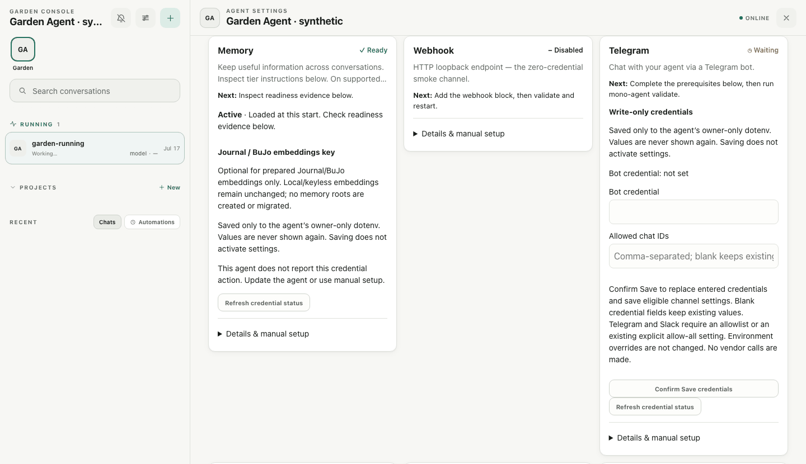
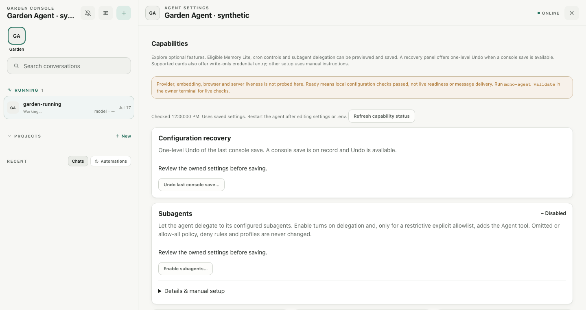

This page lists what an agent can do and where you turn each feature on. Some features have a button in the browser console. Most are one block in `mono-agent.config.json`. A few are CLI commands or are always on. For the complete list of every config key, see the [feature matrix](/reference/feature-matrix/).

:::note[Console Enable and credential fields ship in the published release]
The Capabilities page, its Enable actions, credential fields, and Undo are in the published `0.27.1` release. On older versions, use the config route in the table below. See [Release status](/reference/release-status/).
:::

## Four ways to turn something on

- **Console: Enable.** On a supporting agent, **Agent settings → Capabilities** has an Enable button for three features: **Enable Memory Lite…**, **Enable cron controls…**, and **Enable subagents…**. Each one previews the exact config it will write and saves only after **Confirm Save**.
- **Console: credentials.** Some Capabilities cards have write-only fields for a secret such as a bot token or API key. The value goes to the agent's `.env` file and is never shown again. Saving a Telegram, Slack, or OpenAI-compatible API credential also turns that channel on in the config.
- **Config.** Edit `mono-agent.config.json` (and `.env` for secrets), run `mono-agent validate`, then restart the agent. Every Capabilities card has **Details & manual setup** with the exact block to add, so you can use the card as a guide even when it has no button.
- **CLI or always on.** A few features are a command (`mono-agent sandbox setup`, `mono-agent auth login`) or need no setup at all.

Every console save changes the config file, not the running agent. The card says **Saved; applies on next start** until you restart: use **Restart to apply…** for a background agent, or stop and start a foreground agent yourself. See the [tutorial's step 5](/getting-started/tutorial/#5-turn-on-one-feature-from-the-capabilities-page) for the full flow.

## Feature by feature

### Conversations and models

| Feature | What the agent gets | How to turn it on | Learn more |
| --- | --- | --- | --- |
| Browser console | Persistent conversations, attachments, projects, tags, notifications, PDF export | Always on. Start it with `mono-agent web run --loopback`. | [Web console](/observability/web-console/) |
| Model routes and fallbacks | A primary model, ordered fallbacks, and per-route effort | **Config:** `runtime.model`, `runtime.fallbacks`. The `init` wizard sets these up. In the console, you choose among configured routes per conversation and in **Agent settings → New conversations**. | [Runtime](/runtime/), [Fallback](/runtime/fallback/) |
| Provider sign-in | Subscription or API-key access to cloud models | **CLI:** `mono-agent auth login <provider>`. In the console, **Agent settings → Providers** shows sign-in state and usage, and its **Authenticate** action signs in from the browser. | [Install](/getting-started/install/#prerequisites), [Provider authentication](/observability/web-console/#authentication-and-live-checks) |
| Local models | Ollama or LM Studio models, no account needed | **Config:** a model ref such as `ollama:<model>`; `providers.local[]` | [Local providers](/runtime/local-providers/) |
| Identity and role | What the agent is for and how it behaves | **Config:** edit `IDENTITY.md` (referenced by `context.identityPath`) | [Identity & soul](/context/identity-and-soul/) |

### Tools and safety

| Feature | What the agent gets | How to turn it on | Learn more |
| --- | --- | --- | --- |
| Built-in tools | Read and edit files, run commands, background jobs | On by default (allow-all). **Config:** narrow with `tools.allowedTools` / `tools.disallowedTools`. | [Tool policy](/tools/policy/) |
| MCP servers | Extra tools from MCP servers you prepare | **Config:** `tools.mcpConfigPath` pointing to an `mcp.json` | [MCP](/tools/mcp/) |
| Web research | `WebSearch` and `WebFetch` | **Config:** `tools.web.*`. **Console: credentials** for an already-selected provider: **Parallel search key**, **Parallel fetch key**, **Hosted Ollama search key** (on the MCP / tools card). | [Web research](/tools/web-research/) |
| Subagents | Delegate focused work to configured subagents | **Console: Enable subagents…** on the **Subagents** card, once a `subagents` block exists. **Config:** `subagents.enabled` plus `Agent` in a restrictive `tools.allowedTools`. | [Subagents](/runtime/tools-and-guards/#subagents-agent) |
| Sandbox | Commands confined by a filesystem and network policy | **Config:** the `sandbox` block (the `init` wizard asks about it). **CLI:** `mono-agent sandbox setup` installs the runtime on macOS. | [Sandbox](/tools/sandbox/) |
| Skills | Reusable `SKILL.md` instructions loaded into context | **Config:** `context.skillsRoot`, `context.selectedSkills` | [Selected skills](/context/skills/) |

### Memory

| Feature | What the agent gets | How to turn it on | Learn more |
| --- | --- | --- | --- |
| Memory Lite | Local full-text recall across conversations | **Console: Enable Memory Lite…** on the **Memory** card, for an agent with no memory configured. **Config:** `memory.mode: "lite"`, or `mono-agent init --memory lite` on a new folder. | [Memory](/memory/#enable-lite-from-the-console) |
| Memory Journal and BuJo | Semantic recall with embeddings; BuJo adds model-guided capture and consolidation | **Config:** `memory.mode: "journal"` or `"bujo"` with an embeddings block, or `init --memory journal` / `--memory bujo`. **Console: credentials** for a prepared hosted embeddings key (**Journal / BuJo embeddings key**). | [Memory tiers](/memory/#memory-tiers), [Embeddings](/memory/embeddings/) |

### Channels and automation

| Feature | What the agent gets | How to turn it on | Learn more |
| --- | --- | --- | --- |
| Telegram | Chat with the agent through a Telegram bot | **Console: credentials** on the **Telegram** card: bot token plus allowed chat IDs. Saving turns `telegram` on. **Config:** `telegram.enabled` plus the token in `.env`. | [Telegram](/channels/telegram/) |
| Slack | A Socket-Mode Slack bot scoped to allowed channels | **Console: credentials** on the **Slack** card: bot and app tokens plus allowed channel IDs. **Config:** `slack.enabled` plus tokens in `.env`. | [Slack](/channels/slack/) |
| OpenAI-compatible API | An OpenAI-style endpoint other tools can call | **Console: credentials** on the **OpenAI-compatible API** card: the client bearer that callers must send. **Config:** `openaiApi.enabled`. | [OpenAI-compatible API](/channels/openai-api/) |
| Webhook | A loopback HTTP endpoint for scripts | **Config:** `webhook.enabled`, or `mono-agent init --with webhook` | [Webhook](/channels/webhook/) |
| Scheduled jobs (cron) | Run the agent on a schedule | **Config:** a `cron` block with jobs. Then **Console: Enable cron controls…** turns on the console's **Run now** and **Enable/Disable** job actions for existing valid jobs. It never creates or enables jobs or schedules. | [Cron](/channels/cron/#enable-operator-controls-from-the-console) |
| A2A provider | Expose the agent to other agents over A2A | **Config:** install and configure the `@mono-agent/channel-a2a` plugin. **Console: credentials** for the **A2A provider bearer**. Saving never installs or enables the plugin. | [A2A](/channels/a2a/) |
| WhatsApp and Messenger | Plugin channels | **Config:** `channels.plugins[]` | [WhatsApp](/channels/whatsapp/), [Messenger](/channels/messenger/) |

### Observability

| Feature | What the agent gets | How to turn it on | Learn more |
| --- | --- | --- | --- |
| Built-in tracing and run evidence | Local records of every run for diagnostics | Always on. Inspect with `mono-agent runs list` and `mono-agent runs show <run-id>`. | [Run artifacts & traces](/observability/artifacts-and-traces/) |
| Live checks | Provider, embedding, and channel readiness | **CLI:** `mono-agent validate`. The Capabilities page shows local configuration checks only. | [Setup reference](/getting-started/quickstart/#2-validate-cli) |

## Credential cards

*Synthetic example. Credential fields are always empty; status shows only "set" or "not set".*

Credential fields are write-only. Values are saved only to the agent's owner-only `.env` file and never shown again, and status shows only whether a value is set. A blank field keeps the saved value. **Confirm Save credentials** checks local prerequisites, then writes `.env` and the config. Telegram and Slack need an allowlist (or an explicit allow-all setting you made yourself); the console never sets allow-all. No vendor calls are made, and nothing is active until the next start. Model-provider sign-in is not on these cards: use `mono-agent auth login` or **Agent settings → Providers**.

If the `.env` save succeeds but the config write does not, the card shows **Saved; config pending** with **Retry configuration only**, so you do not have to enter the secret again. The [web console guide](/observability/web-console/#discover-optional-capabilities) covers every credential state, environment-name rule, and refusal.

## Undo a console save

After a console save, the **Configuration recovery** panel offers **Undo last console save…**. Undo restores the exact previous file, including its formatting, and then restart applies it. There is one level of undo: a second Undo is refused, and any manual edit after the save makes Undo unavailable instead of guessing. Undo never deletes `.env` credentials or memory data, so credential cards can still show "set" afterwards.

## Not in the console

These stay config or CLI only, even on a supporting agent: model routes, identity, tool policy, MCP servers, skills, the sandbox, webhook, Journal and BuJo memory setup, creating cron jobs, and plugin channels. There is no terminal Enable command; the CLI equivalent is editing the config and running `mono-agent validate`. For agents that do not report capabilities (published releases before 0.27.0), every feature uses the config route.
