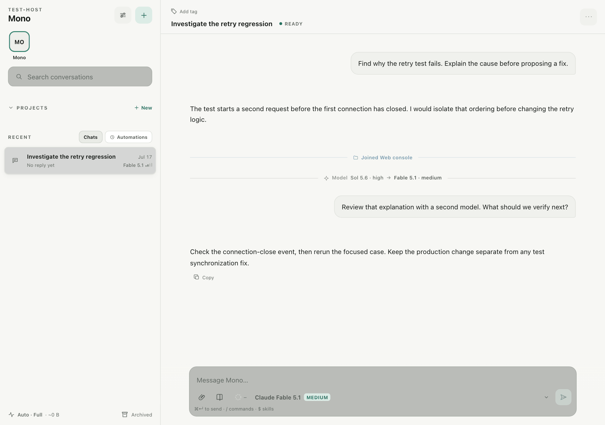
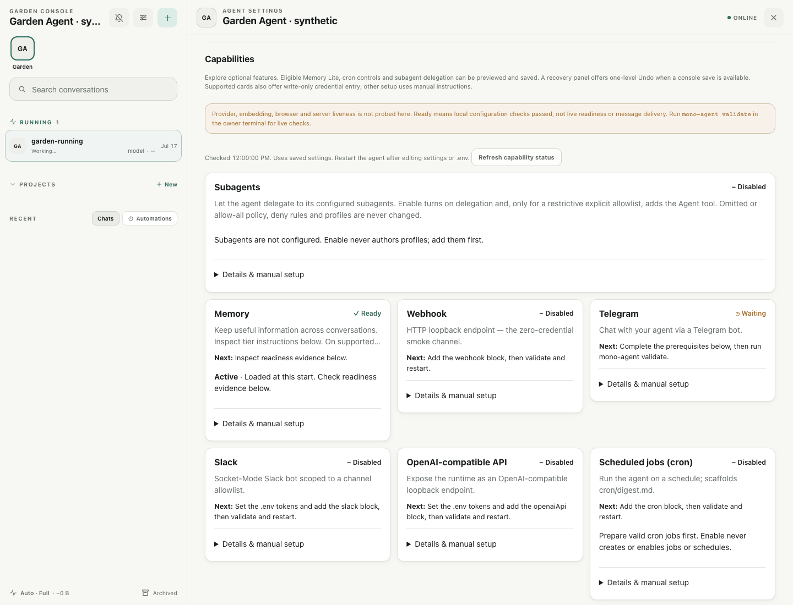
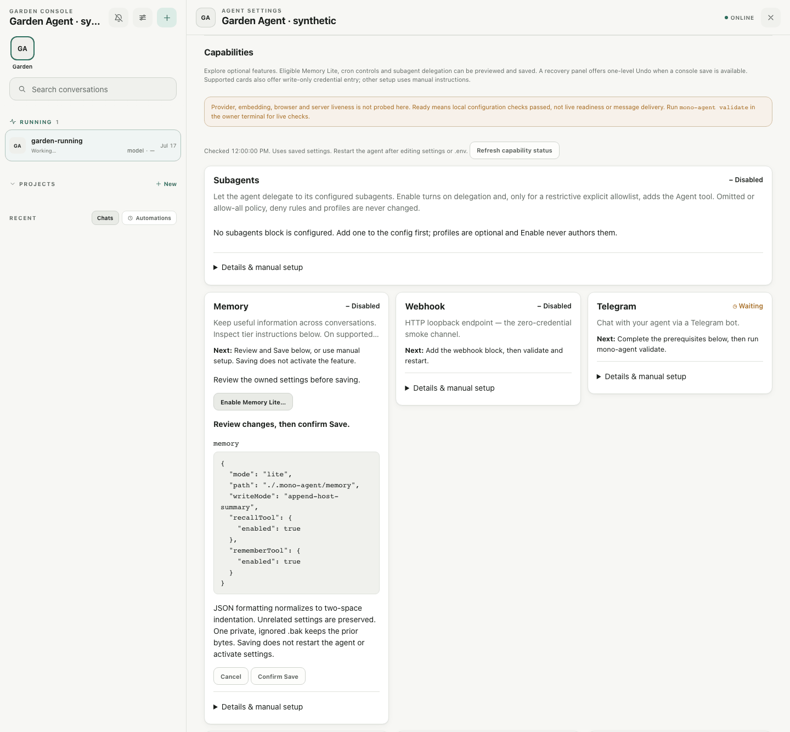
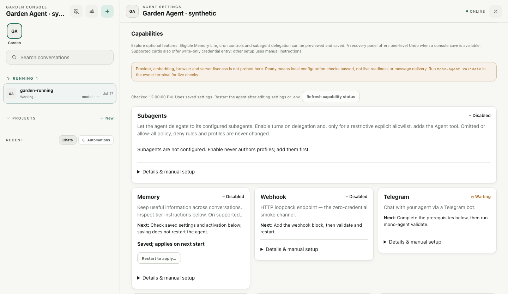

This tutorial takes a computer with nothing installed to a working agent you talk to in the browser console, then turns on one optional feature. Each step says what to run, what you should see, and what to do if it fails. Detailed reference for every command lives in [Install & prerequisites](/getting-started/install/) and the [setup reference](/getting-started/quickstart/).

You need:

- macOS or glibc Linux (x64 or arm64) for the one-line installer. On Windows, or if you prefer to manage Node yourself, use npm with Node.js `>=24.15.0` (step 1 shows how).
- A model provider account you can sign in to (for example OpenAI Codex, Anthropic, or GitHub Copilot), or a local [Ollama or LM Studio](/runtime/local-providers/) server.
- Two terminal windows and a browser on the same computer.

:::note[All five steps work with the published release]
The latest published release is `0.27.1`. These docs describe the current `main` source, and every feature in this tutorial is in the published release, so all five steps work with a published install. [Release status](/reference/release-status/) tracks what each published version contains.
:::

## 1. Install the CLI

On macOS or glibc Linux, run the installer as your normal user (not with `sudo`):

```bash
curl -fsSL https://mono-agent.dev/install.sh | sh
```

The installer downloads an official Node.js `24.15.0`, checks it against nodejs.org's checksums, and installs the published `create-mono-agent` package with that private Node under `~/.mono-agent/cli`. Your system Node, npm, and pnpm are not used or changed, so a wrong or missing system Node cannot break the CLI. It does not edit shell startup files unless you pass `--add-to-path`.

**You should see** progress lines and then something like:

```text
Installed mono-agent 0.27.1 with private Node 24.15.0 (ABI 137).
CLI: '/Users/example/.mono-agent/cli/bin/mono-agent'
Activate in this shell: export PATH='/Users/example/.mono-agent/cli/bin':"$PATH"
Next: '/Users/example/.mono-agent/cli/bin/mono-agent' init
```

Your path shows your own home folder in place of `/Users/example`. Run the printed `export PATH=…` line in your terminal (and in the second terminal you will use later), then confirm the command resolves:

```bash
mono-agent --version
```

Prefer to read the script first? [Install & prerequisites](/getting-started/install/#private-node-installer-macos-and-linux) shows the download-inspect-run sequence with the published checksum.

**On Windows, or with your own Node:** install Node.js `>=24.15.0`, then install the CLI globally with npm:

```bash
node --version              # must print v24.15.0 or newer
npm i -g create-mono-agent
```

**If it fails:** the installer stops with a `mono-agent installer:` message. The common ones:

| Message | What to do |
| --- | --- |
| `refusing root; run as your normal user without sudo` | Rerun the command without `sudo`. |
| `Linux requires glibc; musl/Alpine is unsupported.` or `official Node requires glibc >=2.28` | Use a supported host, or install Node yourself and use the npm route. |
| `unsupported OS: …` or `unsupported architecture: …` | Use the npm route with a Node you manage. |
| `required tool missing: <tool>` | Install that tool (for example `curl`, `tar`, or `shasum`/`sha256sum`) and rerun. |
| `npm installation failed; existing generation preserved.` | Read the npm error above it. Network, proxy, or custom-CA problems are the usual cause; [proxy and CA variables](/getting-started/install/#private-node-installer-macos-and-linux) are supported. If a native dependency had to compile, install a compiler toolchain. |
| `another installer is active (or a stale ~/.mono-agent/.cli-install-lock needs manual inspection)` | Wait for the other run to finish. Remove the lock directory only after confirming no installer is running. |
| `Another mono-agent takes precedence: <path>` | An older `mono-agent` is earlier on your `PATH`. Your path shows your own home folder in place of `/Users/example`. Run the printed `export PATH=…` line, or call the absolute CLI path. |

A failure after the CLI was published leaves it installed and starts no services, so you can fix the problem and rerun the installer.

## 2. Check the host

The installer ends by running a host check. What you see depends on the CLI version it installed.

**With a published version before 0.27.0** the installer prints:

```text
Warning: host preflight unavailable in this version. CLI installation verified; host readiness is not established.
```

That is expected, not an error: those versions predate `mono-agent preflight`. Continue with step 3; problems with native dependencies will surface there or in `mono-agent validate`.

**With a version that includes preflight** (0.27.0 and later, or a [source build](#run-this-tutorial-from-source)), the installer prints the results, and you can rerun the check from any folder:

```bash
mono-agent preflight
```

It reads no config, credentials, or `.env`, and makes no model calls. Output from a macOS computer that has Ollama and LM Studio running but no sandbox set up looks like this (the installer prints the same checks in a slightly shorter form):

```text
Host preflight: no errors (Node 24.15.0, required >=24.15.0, ABI 137)
[ok] runtime.node: Node 24.15.0; required >=24.15.0.
[ok] runtime.node-abi: Running Node ABI 137; native load checks determine compatibility.
[ok] native.memory: better-sqlite3 and sqlite-vec loaded and queried in memory.
[ok] native.sharp: sharp loaded and encoded a tiny image.
[ok] service.manager: User service manager is reachable.
[ok] models.ollama: ollama loopback model-list endpoint is reachable (no inference performed).
[ok] models.lmstudio: lmstudio loopback model-list endpoint is reachable (no inference performed).
[warning] sandbox.runtime: Sandbox is unavailable or could not be verified; sandboxed execution is optional.
  Optional: install/repair the pinned user-cache sandbox; no global installation.
  $ mono-agent sandbox setup
[ok] console.port: Console loopback port is available (snapshot only).
```

**Exit code 0 means no errors.** `info` and `warning` lines describe optional capabilities and never block setup. Every non-`ok` line prints the command that would fix it; nothing is repaired automatically.

**If it fails:**

| Check | What it means | What to do |
| --- | --- | --- |
| `[error] native.memory` or `[error] native.sharp` | A native dependency does not load under this Node. This usually means it was installed or built with a different Node version. | Stop running agents, select a supported Node, and reinstall or rebuild with that same Node. Preflight prints the rebuild or reinstall commands that match your install. |
| `[warning] service.manager` | No usable background service manager. | Run the agent with `mono-agent start --foreground` later. |
| `[warning] console.port` | Port 5050 is taken. | Start the console later with the suggested `--port`. |
| `[warning] sandbox.runtime` | The optional sandbox is not set up. | Optional: run the printed command, such as `mono-agent sandbox setup` on macOS. |
| `[info] models.ollama` or `[info] models.lmstudio` | No local model server is running. | Optional: only needed if you want local models. |

**Wrong Node version.** Versions that include preflight also check Node before every command. On an unsupported Node, any `mono-agent` command stops before loading configuration or native dependencies and prints:

```text
mono-agent requires Node.js >=24.15.0; found 22.11.0.
Select a supported Node before retrying (choose one alternative):
  nvm install 24.15.0 && nvm use 24.15.0
  fnm install 24.15.0 && fnm use 24.15.0
  volta install node@24.15.0
  Official installer: https://nodejs.org/en/download
```

The private installer always runs the CLI on its own supported Node, so this mainly affects npm and source installs. Switching Node does not rebuild dependencies that are already installed. After switching, reinstall (or rebuild a source checkout) with the new Node before you start agents again. The [preflight reference](/observability/cli-reference/#host-preflight) lists every check ID, status, and exit code.

## 3. Create the agent

Make an empty folder for the agent and run the guided setup in it:

```bash
mkdir my-agent
cd my-agent
mono-agent init
```

Run bare `init` in a real terminal. With any flag, or without a TTY, `init` only writes files and makes no readiness claim.

**You should see** a step-by-step wizard: choose a preset or a custom setup, name the agent, enter its Role, pick a primary model and optional fallbacks, and decide about optional capabilities (leave them at **No** for this tutorial; step 5 adds one later). You then confirm tool access and the sandbox choice, and review exactly what will be created. The wizard signs you in to the provider if needed. It then makes one real, tool-free model request per selected route to prove each one answers. That can take a few minutes and counts as usage on your account.

How setup ends depends on the platform:

- **macOS:** `init` also starts the agent in the background and prints `Agent ready — the background process reported startup complete.`, followed by a **Chat in the browser** list of next commands.
- **Linux:** the same checks run, then `init` prints **Manual start required** with the commands for terminal 1 (the agent) and terminal 2 (the console). It does not install the background service for you.

On versions with the console handoff (0.27.0 and later, or a source build), setup then asks **Open the browser console?** The default answer is **Not now**. You can also choose **Start / reuse managed console** or **Run foreground console in this terminal (Ctrl-C to stop)**. The prompt first warns that the console has no login. If you accept, the link it opens goes straight to this agent's Capabilities page, which you will use in step 5. Choosing **Not now** is fine: step 4 starts the console by hand.

**If it fails:**

- **A route check fails or times out.** The wizard offers to resume checks that already passed, restart all checks, edit your choices, or cancel without writing. Provider sign-in problems can also be fixed separately with `mono-agent auth login <provider>`, for example `mono-agent auth login openai-codex`.
- **`The validated agent files were preserved, but the background agent is not ready.`** (macOS) Run `mono-agent validate` in the folder and fix every `[error]` section, then `mono-agent start`.
- **You ran `init` with flags or from a script.** That wrote a scaffold only. Run `mono-agent validate`, then start the agent yourself in step 4.

The [setup reference](/getting-started/quickstart/#setup-details-guided-init-flags-and-files) documents every wizard branch, flag, deadline, and generated file.

## 4. Start the console and send a first message

First make sure the agent itself is running:

| Situation | Run in terminal 1 |
| --- | --- |
| macOS after guided `init` | Nothing to start. `mono-agent status` confirms it is running. |
| Linux with a systemd user manager | `mono-agent start` |
| No usable service manager, or any other host | `mono-agent start --foreground`, and keep this terminal open |

Then start the browser console in terminal 2 and leave it open:

```bash
mono-agent web run --loopback
```

Open `http://127.0.0.1:5050`. **You should see** the console with your agent in the sidebar. Select the agent, type in the **Message …** box at the bottom, and send with ⌘↵ (macOS) or Ctrl+↵, or the **Send message** button. The reply appears in the conversation. Conversations live in the console service, so refreshing or closing the tab does not stop a running turn.



*Synthetic example data. Your sidebar shows your own agent and conversations.*

`web run --loopback` listens only on this computer and never configures a Tailscale route. The console has **no login**: anyone who can reach it can use your agents. Read the [console security boundary](/observability/web-console/#security-boundary-trusted-network-no-login) before widening it with `--host` or sharing it.

**If it fails:**

| Symptom | What to do |
| --- | --- |
| The console does not start because the port is in use | Run `mono-agent web run --loopback --port 5051` and open that port instead. |
| Your agent is not in the sidebar | The agent is not running. Check terminal 1, or run `mono-agent status` for a background agent. |
| The message fails or no reply arrives | Run `mono-agent validate` in the agent folder. A `[waiting]` or `[error]` runtime or provider section means the model route needs sign-in or a reachable local server. |
| The page loads on another computer | It is reachable through a proxy or route you set up before. See the [console security boundary](/observability/web-console/#security-boundary-trusted-network-no-login). |

## 5. Turn on one feature from the Capabilities page

*Works with the published release for both the agent and the console.*

Select the **Agent settings** button at the top of the sidebar (a sliders icon next to the **New conversation** `+` button; its tooltip reads "Agent settings") and scroll to **Capabilities**. With the agent selected, you can also open `http://127.0.0.1:5050/?settings=capabilities` directly; to open a specific agent's page, use `http://127.0.0.1:5050/?agent=<source-id>&settings=capabilities`, the link shape the `init` console handoff opens.

**You should see** one card per optional feature: memory, webhook, Telegram, Slack, the OpenAI-compatible API, scheduled jobs (cron), the A2A provider, the sandbox, MCP / tools, built-in tracing, and a separate Subagents card. Each card shows a status (**Ready**, **Waiting**, **Disabled**, or **Needs attention**), a short **Next:** hint, and **Details & manual setup** with the exact config and `.env` steps.



The statuses come from the agent's own local configuration checks. **Ready** means the configuration checks passed, not that a provider or channel was contacted; run `mono-agent validate` for live checks. An agent from an older version shows `This agent version doesn't report capabilities.` instead of cards.

Now turn on Memory Lite, which keeps useful information across conversations with local full-text recall and needs no extra service:

1. On the **Memory** card, select **Enable Memory Lite…**.
2. Review the preview. It shows only the `memory` block that will be written. Unrelated settings are kept, and a private backup of the previous file is saved.
3. Select **Confirm Save**, or **Cancel** to write nothing.



Saving changes the config file but does not change the running agent. The card says **Saved; applies on next start**:

- **Background agent:** select **Restart to apply…**, then **Confirm restart** in the Restart section. After the agent is back, select **Refresh capability status**. The card shows **Active** once the new start has loaded the setting.
- **Foreground agent:** press Ctrl-C in terminal 1 and run `mono-agent start --foreground` again.



Changed your mind? While nothing else has edited the file since, the **Configuration recovery** panel at the top of Capabilities offers **Undo last console save…**, which restores the exact previous file. Restart again to apply the undo.

**If it fails:**

| Message on the card | What to do |
| --- | --- |
| `Memory is configured. Tier changes require manual preparation; no migration is offered.` | Memory is already set up (for example by a preset). Nothing to enable. |
| `The standard memory root is not empty or verified Lite.` | Existing data is in `./.mono-agent/memory`. The console never moves or deletes it; inspect it in a terminal. |
| `An environment setting conflicts with this action.` | An environment variable overrides this setting. Resolve it in the agent's terminal. |
| `Saved, but not active at this start — check evidence` | The agent restarted without loading the setting. Run `mono-agent validate` and check its output. |
| A conflict or uncertain-save notice | Refresh capability status and review a new preview. Never retry blindly. |

## What next

- Tour everything else an agent can do, and where each feature is turned on: [Feature tour](/getting-started/feature-tour/).
- Let a coding agent such as Claude Code or Codex do this setup for you: [Set up with a coding agent](/getting-started/coding-agent-setup/).
- Change models, identity, tools, and channels by editing the config: [setup reference](/getting-started/quickstart/#make-it-yours) and the [config blueprint](/config/blueprint/).
- Learn the console in depth: [Always-on web console](/observability/web-console/).

## Run this tutorial from source

The published release covers every step above. Use a source build only to evaluate changes that are newer than the published release. A source build needs your own Node.js `>=24.15.0` and pnpm `>=10.16.0`. The private installer's Node is not used for this.

```bash
git clone https://github.com/robertsreberski/mono-agent.git
cd mono-agent
pnpm install --frozen-lockfile
pnpm run build
alias mono-agent="node $PWD/packages/app/dist/cli.js"
mono-agent preflight
```

Then follow steps 3 to 5 in a separate, empty agent folder, using that alias in every terminal. Both the agent and the console must come from the same source build: a published 0.26.0 agent shows `This agent version doesn't report capabilities.` even in a source-built console. A source build is for evaluation, not a published version other machines can pin. Rebuild after pulling changes. See [Run an unreleased build](/getting-started/install/#run-an-unreleased-build) for the caveats.
