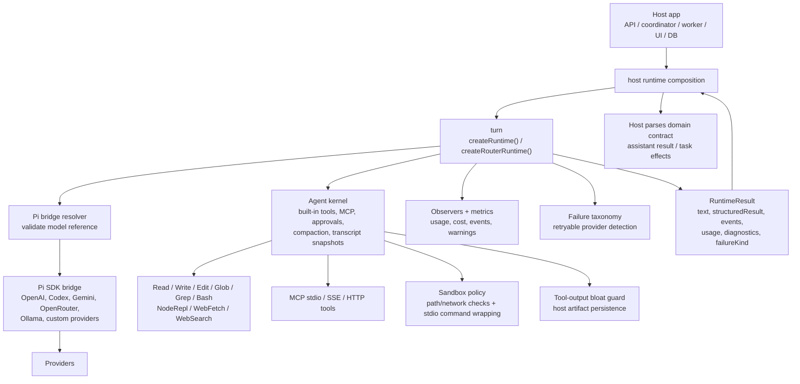
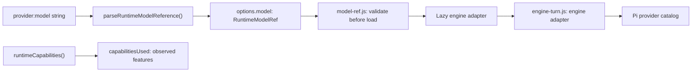
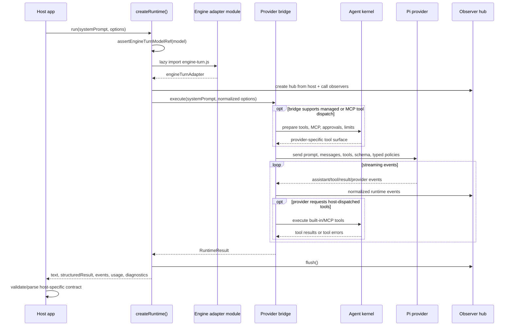
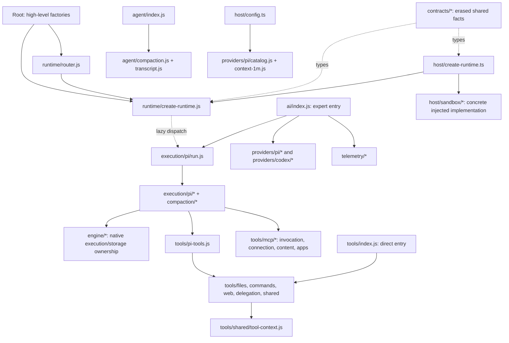
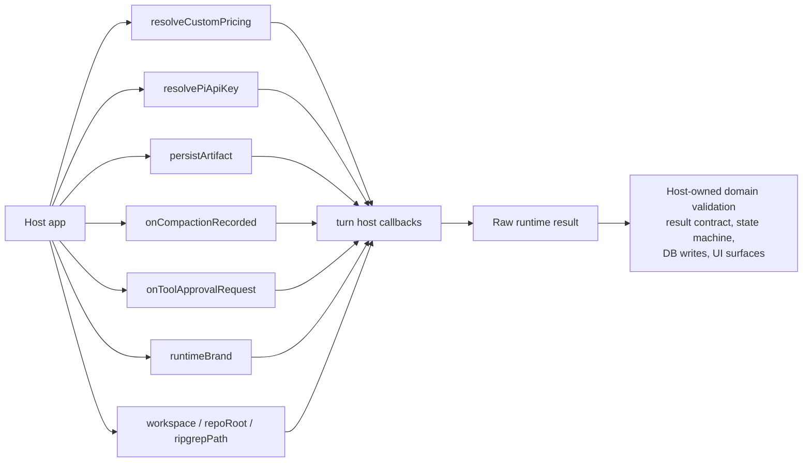

# Agent Runtime Architecture

## What It Is

`@mono-agent/turn` is a provider-agnostic agent execution
kernel. It does not own tasks, database state, UI, scheduling, or a host's
domain-specific result contract. It owns the lower-level act of running an
agent turn:

- pick the right backend from a model reference and execution mode
- expose built-in tools, MCP tools, approvals, structured output, and live input
- enforce an optional sandbox policy for built-in tool execution and stdio MCP
  startup, through an injectable seam (see `agent/sandbox-seam.js`) with the concrete implementation owned by `src/host/`
- normalize provider events into one runtime event stream
- classify runtime failures and retryable provider errors
- collect usage, cost, cache, capability, and warning telemetry
- return raw text plus raw structured output to the host

Typed hosts use `@mono-agent/turn/host`; low-level consumers can still
inject their own sandbox through `createRuntime()` / `createRouterRuntime()`.
The package depends on contracts for host contracts/errors and owns its isolated
`src/engine` for native execution/storage. One staged production compiler graph
emits JavaScript and declarations into `dist`. Host runtime entries remain under
`dist/host`; the other runtime entries still ship from `src` with declarations in
`types` until the final artifact transition. Converted implementations and their
declarations at those legacy paths are copies of that same compiler output,
never authored forwarding modules. Strict source/test checks emit nothing; a
separate check-only strict declaration emit must match every authored TS
declaration in the production output. Its quarantined output is never shipped.
Private source declaration overlays are owned, temporary inputs to those checks
and are removed in `finally`, including recovery after interrupted runs.
The host entrypoints split construction, config validation, contracts and sandbox
support without adding a forwarding package. Config remains a separate package.

## Package Boundary

**Diagram summary:** A host constructs `createRuntime()` or `createRouterRuntime()`.
The runtime selects the Pi provider bridge while sharing observability,
failure normalization, and capability-specific agent/tool services. It returns
a provider-neutral result for the host to interpret.

The runtime stays below host domain behavior. Provider code in this package
must not import host DB, API, coordinator, or UI modules. Hosts pass callbacks
and typed runtime policies into the runtime instead.

## Runtime Selection

**Diagram summary:** Hosts parse a canonical provider/model reference. The
runtime validates that reference before lazily importing the engine adapter.
Capability metadata remains available without loading provider code.

`createRuntime().run()` requires the parsed object and does not parse strings
implicitly. Provider and model fallback chains remain owned by the router;
every accepted route executes through Pi.

## Host prompt assembly and replay

The harness's complete `prompt` and typed `sections` describe inspection context.
Dispatch uses its separate `systemPrompt`: core/SOUL → identity → stable skill
index/guidance → selected skill bodies → fixed host-envelope instruction. The
runtime adds its structured-output instruction without moving it into host
history. Session facts and the conditional warm-skill paragraph live in the
leading `<host_turn_context>` envelope on every current user message. That
latest envelope supersedes older copies; quoted surface labels, user/history,
memory and tool output remain untrusted. Tool enforcement and delivery routes
do not derive authority from envelope text.

Every harness-prepared cold run and stale-session retry supplies chronological canonical
messages with deterministic speaker/timestamp labels, then the bounded untrusted
tool-history projection, then one current user message (envelope, existing
speaker/preceding-message/user/attachment text, recall suffix). Legacy system/tool
history is labeled untrusted text, not system authority or native tool calls.
Inspection, canonical history and provider transcripts remain distinct: the host
never persists the envelope into canonical user text or memory capture and does
not use it as a recall query. Configured last-64 retention is unchanged.

Only the primary's first router attempt may retain a provider session. A retry or
backup after a warm primary failure has the current message and bounded
failed-attempt snapshot, without the earlier conversation. Its answer retires the
coordinated durable epoch; the next turn reseeds from canonical history. Fresh
stateless Pi calls use a private in-memory repository so their stable attribution
id cannot collide with or delete the primary's transcript.

### Tool exposure versus admission

Tool definitions follow the configured authority profile, not the current turn's
controllers. User, process-job wake and cron turns keep the same
provider-visible definitions within an unchanged profile; persistent children
have their own profile and retain structural recursion/MCP exclusions.
Unavailable operations remain visible but refuse before execution. Current
availability/reasons, lineage budgets, command ceilings and
persistent-child/recovery capabilities appear only in the latest non-authorizing
`host_turn_context`, never in tool schemas or canonical history. Children use
the same envelope formatter. No previous controller or tool snapshot is retained.

Builtins, skill names, MCP servers and source tool names use deterministic
code-unit ordering, including before MCP collision naming. Real configuration,
model, output-schema or skill-catalog changes can still change definitions, as
can third-party schema changes and explicitly warned infrastructure discovery
failures. Stable definitions do not guarantee a provider cache hit.

## Run Lifecycle

**Diagram summary:** The host calls `run()`, the runtime lazily loads one bridge,
and that bridge talks to its SDK or subprocess. Supported tool calls pass through
the shared kernel, provider events are normalized, and the host receives a result
that it must validate for its domain.

The Pi bridge captures structured output as `structuredResult`. The package
does not validate captured output against a host domain schema. Hosts own
that validation and all state-machine side effects.

## Main Subsystems

**Diagram summary:** High-level factories, expert AI, direct tools, and agent
policy are separate public entries. Runtime coordination and telemetry are
separate from provider integration and Pi execution. Shared leaf contracts feed
both JavaScript execution and typed host projections without implementation
back edges. Native session ownership remains in `engine/`.

Key responsibilities by subsystem:

- `runtime/create-runtime.js`: binds host callbacks once, builds a per-instance `ToolContext`
  (`tools/shared/tool-context.js`) threaded to every bridge call via
  `options.toolContext`, and directly dispatches each validated call to the lazily loaded adapter.
- `runtime/bridges.js`: optional lookup validates before lazily loading the adapter;
  its descriptor-list wrapper preserves lazy capability introspection.
- `runtime/router.js`: retries across an ordered fallback chain on retryable
  provider failures, carrying a transcript-tail resume snapshot forward.
- `providers/*`: owns provider integration, authentication, catalog metadata and wire adaptation.
- `execution/pi/*`: owns turn orchestration, normalized results/events, structured-output
  extraction and compaction coordination over native engine evidence.
- `tools/{files,commands,web,delegation,mcp,shared}`: implements built-in tools, path/workdir guards, sandbox
  policy checks, MCP tool adaptation, Playwright artifact routing, and output
  limits.
- `agent/sandbox-seam.js`: the injectable `RuntimeSandbox` interface (policy
  merge, command preparation, network-allow checks) and its zero-dependency
  `passthroughSandbox` default (no policy configured → unsandboxed, exactly as
  before; a policy configured with no implementation injected → fails closed).
  Real hosts inject `@mono-agent/turn/host`'s sandbox implementation.
- `agent/compaction.js`: derives adaptive compaction budgets and clamped output
  limits directly from typed `toolLimits` / `compaction` inputs and the model;
  estimates fixed request overhead and classifies context-pressure errors. Pi
  drives proactive compaction and reactive recovery through `compact()` (formerly `AgentHarness.compact()`).
- `agent/transcript.js`: builds bounded resume snapshots from prior provider
  events so a fallback or continuation can keep context.
- `agent/approval.js`: provides host-driven human-in-the-loop tool approval
  gates where the backend supports runtime tool dispatch.
- `telemetry/failure.js`: normalizes spawn, usage-limit, provider, cancellation, and
  retryability decisions into stable failure kinds.

## Host Responsibilities

**Diagram summary:** The host injects pricing, Pi credentials, artifact and
compaction persistence, tool-approval decisions, runtime branding, and allowed
filesystem roots. The runtime returns raw normalized data; the host owns domain
validation, durable state, and UI effects.

The host is responsible for:

- resolving credentials and custom provider/model rows before provider calls
- choosing model references, execution mode, effort, fallback chains, and
  runtime settings
- persisting artifacts, raw logs, run rows, and UI-facing state (via the
  `onCompactionRecorded` hook, which fires on every automatic compaction —
  proactive or reactive — the pi bridge drives)
- validating structured output against the host's domain contract
- converting runtime failures into product workflow behavior
- deciding when to retry, recover, continue, cancel, or ask for user input

## Sessions, Follow-ups & Concurrency

When `runtime.session.mode = "continuous"`, the harness keeps a conversation's
provider session warm and serializes its turns through a per-conversation queue
(`@mono-agent/conversation` `LiveSessionManager`). A message that arrives while
a turn is in flight is **queued and answered on the warm session after the
current turn finishes** (queue-after-turn) rather than rejected — this is what
powers follow-up messages in chat channels. Different conversations run
concurrently; an optional `concurrency.maxConcurrentRuns` bounds simultaneous
model runs via admission control around the provider call (queued follow-ups
hold no slot, so the bound never deadlocks against the queue). Note this bound is
**per harness instance** — the app builds one harness per channel, so the limiter
is per-channel, not a single global cap; with N enabled channels the effective
ceiling is N× the configured value. Channels surface
a user cancel through `responder.cancel(conversationId)`, which aborts the
in-flight turn and clears that conversation's queue.

**Honest per-provider session behavior** — parity is *behavioral* (every
provider exposes queue-after-turn), not durability/cost:

The Pi provider integration uses the runtime-owned `src/engine/` for model-run admission,
native journals, storage, retry and compaction. Pi Agent Core supplies the
unforked `runAgentLoop`; Pi AI supplies models and provider requests. The
separate `@mono-agent/conversation` host package owns conversation/history
orchestration. Native lifecycle and journal settlement live in the engine; runtime
façades build results/warnings and retain run-option policy, prefix preflight and
process-wide registry fan-out. The provider glue arms checkpoint compaction for the main prompt. Its guarded
`session_before_compact` hook enforces policy before each turn and between
completed model/tool rounds. Mid-run summaries are separate paid provider
requests inside the same agent run; savings and growth guards limit attempts.
If a turn still overflows, bridge-owned recovery re-prompts at most once after a
preview verifies positive reduction. Fresh compaction suppresses recovery;
meaningful transcript growth after a mid-run cut restores eligibility. Runs report `context_compaction_applied` as `true` (a
compaction fired), `false` (enabled but not needed), or `null` (disabled via
`runtime.compaction.enabled: false`).

`execution/pi/compaction/compaction-summary.js` prepares copies for the attributed harness
`compact()`: bounded tool-result heads/tails, confirmed built-in file operations,
and supplemental summary focus. Its model facade changes only summary context;
model, options, request context and other model methods are forwarded. Each
completion is accounted once at return or rejection. The driver attaches these
rows to terminal compaction events, preserving spend even when a preview rejects
persistence. File metadata and generated prose are measured separately. Native
cut rules and reserve math retain the attributed Pi 0.99.2 baseline. Payload diagnostics correlate
assistant usage independently of these operation-scoped summary requests.

| Active bridge | Warm session | Resume across turns | Survives process restart |
|---|---|---|---|
| **pi** | Yes (mono-agent engine + v2 native journal) | session repo | Yes only with `sessionsRoot` and the durable history/session transaction contract |

The current registry contains only Pi. A confirmed warm session omits host replay.
An unconfirmed durable reopen refreshes the handle and supplies canonical history:
true native resume skips seeding; missing JSONL creates an empty session and seeds
once. Native resume preserves assistant blocks, tool ids/arguments/results and
reasoning signatures. Cold reconstruction has only canonical text, so byte identity
with the original native transcript is not promised. Compaction replaces an older
prefix and keeps a tail; it may remove loaded skill bodies. Fallback routes remain
isolated and stateless, with the same cancellation/reset/failed-commit barriers.

## Essential Takeaway

Think of `@mono-agent/turn` as the portable agent process engine
underneath a host app. The host decides what a task means, which agent should
run, how state changes, and how results are persisted. The runtime decides how
to talk to models through Pi provider dependencies; how tools are
exposed; how provider failures are normalized; and how enough telemetry is
returned for a host to make reliable orchestration decisions.

## Staged conversion procedure

For each remaining JS-to-TS conversion:

1. Start from a completed build/typecheck (recover interrupted views before
   changing inventory). Rename the authored implementation, retaining its `.js`
   import specifiers.
   Preserve exported type-alias versus interface spelling and explicit optional,
   readonly, unknown and union contracts. Never add runtime initializers to make
   a type check pass. `verbatimModuleSyntax` preserves import side effects.
2. Inventory the exact generated legacy `src/<module>.js` and `.js.map` paths in
   this package's `.gitignore`; do not ignore an entire source tree. Remove the
   now-unused adjacent `.d.ts` overlay entry. Update any private `paths` target
   in **both** `tsconfig.json` and `tsconfig.build.json` to the authored `.ts`
   (a test forbids fallback to old types or generated JS).
3. Annotate exported TS contracts when inference differs under strict mode.
   The build compares a strict declaration-only check against the production
   declarations, including host TS, and refuses to ship weaker inferred output.
4. Retarget source-path consumers in the same conversion, preserving a single
   module graph for factories, context state and registries. Do not import a
   sibling package's TS through its `rootDir`; prefer public entries or an
   emitted runtime URL with emitted declaration types.
5. Build before dependent typechecks and parity. Production output is staged,
   strict-checked and only then published. A journal rolls back an interrupted
   publication; failed compilers preserve the last good dist/types/products.
   Strict checks and frozen parity require a fresh source digest. Architecture
   scans intentionally permit edited sources and inspect the authored view.
6. Source-view journals hidden products before deletion and restores them even
   after an interrupted process on the next entry. Signals unwind cleanup; lock
   ownership includes process start time. A lost cache can adopt only listed,
   git-untracked products whose bytes match retained compiler output. Modified
   or unowned files are refused, never automatically removed.
7. Stage named files while the generated products are hidden with `source-view`.
   In particular, stage the old JS deletion, not the materialized compiler copy.
   Run the declaration comparator and applicable source/packed identity tests.

Test-only fixture output lives under root `.worklab-tmp/turn-test-fixtures`,
not any installed-dependency or workspace-package tree. Those trees participate
in runtime build attestation, including package-local caches. Fixture bare-import
specifiers resolve with turn's ESM import conditions and become file URLs; no
node_modules symlink is created. Emitting fixtures must leave the runtime
dependency digest unchanged, so tests cannot poison the next root build.

Authored fixture workers and the sandbox embed runner use `.mts`; their stable
Node launch names remain `.mjs`. The production compiler owns both the dist
runner and its adjacent source-view launch artifact/maps. All other host TS
continues using its existing dist output with source/declaration maps.

`test:fixtures` compiles workers/helpers into the test-only tree and copies raw
data unchanged. Its bounded bootstrap maps emitted workers' relative production
imports, plus transitive public/private turn imports, onto the same `turn/dist`
graph. Fork/exec callers preload that bootstrap with Node `--import`, before
static linking; plain-Node in-process proofs use a native data-URL bootstrap
before importing the compiled helper. Source suites instead load the authored
MTS helper through Vite on their existing source graph; they never redirect a
source test worker to dist or depend on test-only compiler output. Executable
production dependency copies are removed from fixture output;
historical parity roots remain explicit and are never redirected to current code.
The three `packages/turn/scripts/*.mjs` files remain build tooling, not authored
runtime/test sources. The manual golden writer is compiled but never part of
normal test execution; see `engine/__tests__/fixtures/PROJECTION-GOLDENS.md`.
